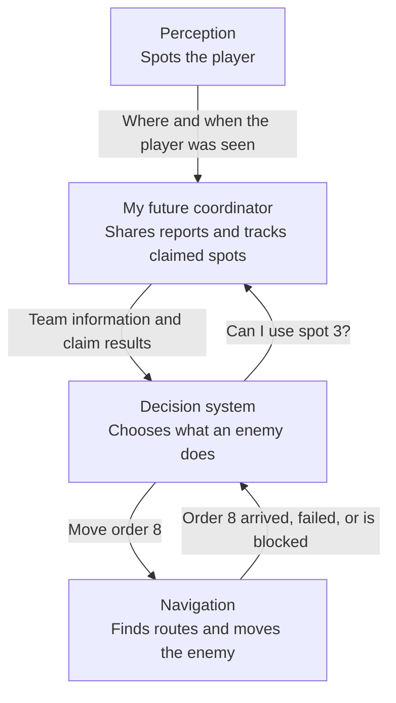

# Step 1 — Giving the enemy systems a common language

Imagine two enemies both wanting the same cover spot. My future coordination system will keep track of who gets that spot. **Step 1 prepares the messages and connections needed to do this.** Sharing information and managing cover will be built in later steps.

## 1. SquadContracts.cs — What goes in a message?

[`SquadContracts.cs`](../../Assets/TacticalGame/Scripts/Coordination/SquadContracts.cs) defines the information a message contains. For example: “Enemy 01 saw the player beside the train at 12 seconds.” A cover claim contains different information: “Enemy 02 owns spot 3.” This file gives everyone the same message formats and names, so teammates' code can understand each other.

## 2. SquadInterfaces.cs — What can one system ask another?

[`SquadInterfaces.cs`](../../Assets/TacticalGame/Scripts/Coordination/SquadInterfaces.cs) lists the questions and requests each system must support. Examples include “What role does enemy 02 have?” and “Can enemy 02 use spot 3?” Think of it as a list of questions and possible answers that the team can build around. Later, we will write the code that actually answers them.

## 3. Movement IDs — Which order is this answer about?

The movement messages in `SquadContracts.cs` give each move an order number. Suppose order 7 says “go to spot 3,” but a new order 8 says “go to spot 5.” A late failure message for order 7 should not cancel order 8. Including the order number lets the receiving code tell them apart when we implement that check.

## 4. Enemy and marker files — Who and where?

[`TargetDummy.cs`](../../Assets/TacticalGame/Scripts/TargetDummy.cs) lets the coordinator read an enemy's ID, position, and whether it is alive. [`TacticalMarker.cs`](../../Assets/TacticalGame/Scripts/TacticalMarker.cs) lets it read a marked spot's ID, position, and purpose, such as cover. Together, these identify **who is asking** and **which spot they want**. They do not yet assign that spot to anyone.

## 5. Settings — Which numbers can we adjust?

[`SquadInterfaceSettings.cs`](../../Assets/TacticalGame/Scripts/Coordination/SquadInterfaceSettings.cs) defines the settings, and [`SquadInterfaceSettings.asset`](../../Assets/TacticalGame/Settings/SquadInterfaceSettings.asset) stores the values we can edit in Unity. One proposed value is five seconds for how long a shared player sighting stays useful. The future coordinator will read this setting when we build its memory behavior.

## 6. Checks — Is the setup ready?

[`CoordinationInterfaceChecks.cs`](../../Assets/TacticalGame/Editor/CoordinationInterfaceChecks.cs) checks the existing maps. It catches problems such as two enemies using the same ID or two spots sharing one ID. It also checks the settings asset. This helps us fix setup mistakes before building the coordination behavior.

## How the pieces connect

The first two files define the messages and requests. The enemy and marker files provide the IDs and positions those messages refer to. Settings provide adjustable numbers, and the check script catches setup mistakes.

The diagram below shows **how the systems will communicate in later steps**:

For example, the decision system asks my coordinator for spot 3. If another enemy owns it, my coordinator will answer “already taken.” The decision system can then try another spot. If it gets a spot, it asks navigation to move there. **Step 1 defines how to make these requests; the working behavior comes later.**

View the diagram in a Markdown preview that supports Mermaid.
