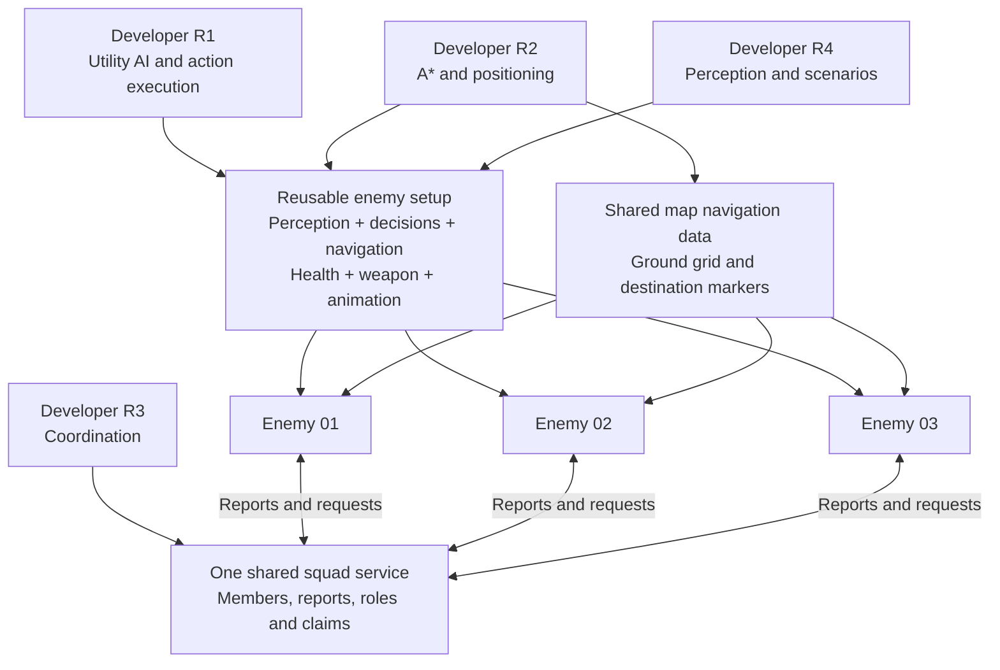
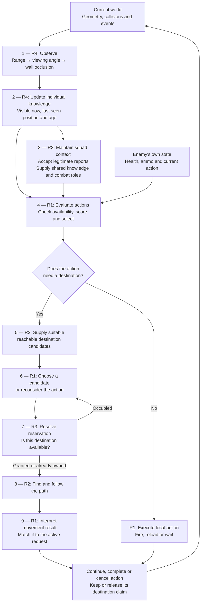
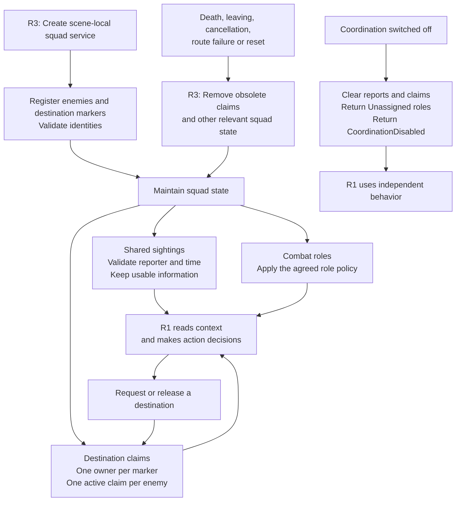
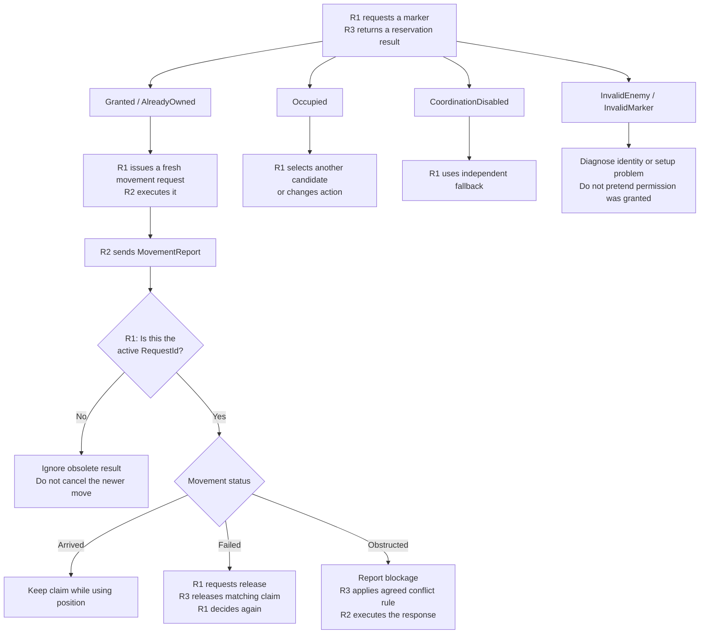
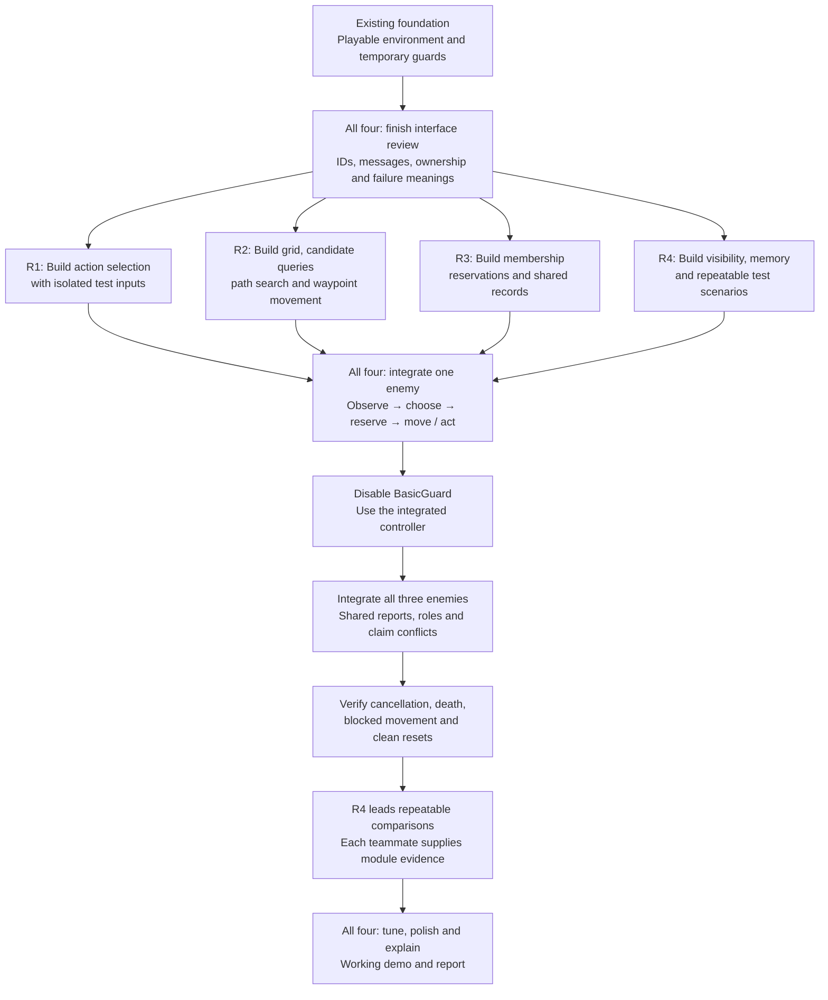
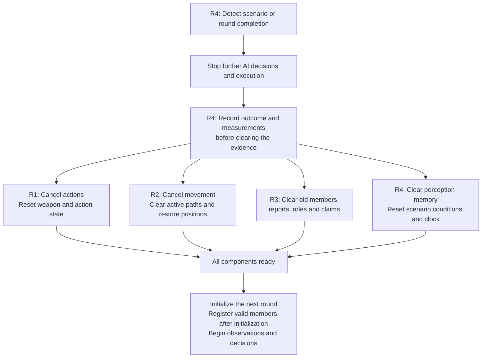
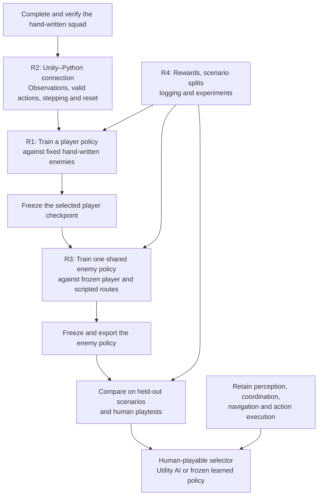

# Team system map — how the four roles work together

**Project:** Last Light / Tactical Enemy AI  
**Status snapshot:** 18 November 2026  
**Purpose:** Understand the responsibilities, interfaces, runtime flow, development order and evaluation of the four-person AI project.

The group is building **one integrated enemy AI system with four developers**. Each of the three enemies will use the work of all four teammates.

These diagrams follow the [3D project plan](project-3-3d-plan.md). **The behavior diagrams describe the intended system.** The shared interfaces exist, but most tactical behavior still needs implementation and teammate review.

The diagrams use Mermaid. Open this document in a Markdown viewer that supports Mermaid to see rendered charts; the diagram source remains readable in a text editor.

## Contents

1. [What the four roles actually mean](#1-what-the-four-roles-actually-mean)
2. [The main runtime loop](#2-the-main-runtime-loop-how-information-becomes-an-action)
3. [Inside each teammate's component](#3-what-happens-inside-each-teammates-component)
4. [The actual interface handoffs](#4-the-actual-handoffs-using-the-interfaces-already-in-the-project)
5. [Coordination responsibilities](#5-coordination-responsibilities-step-by-step)
6. [Failure handling](#6-failure-handling-where-the-components-must-cooperate)
7. [A concrete walkthrough](#7-a-concrete-walkthrough-across-all-four-roles)
8. [The development workflow](#8-the-development-workflow-who-builds-what-first)
9. [Cleanup and evaluation](#9-end-of-round-cleanup-and-evaluation)
10. [Optional machine-learning extension](#10-optional-later-extension-where-machine-learning-would-fit)

## 1. What the four roles actually mean

| Developer | Main question their component answers | Main responsibility |
|---|---|---|
| **R1 — Utility AI** | “What should this enemy do now?” | Score actions, choose one, manage its execution and cancellation |
| **R2 — A* and positioning** | “Which positions are suitable and reachable, and how should the enemy get there?” | Ground grid, candidate positions, paths, movement |
| **R3 — Coordination** | “What does the squad know, and who is using which position?” | Shared sightings, combat roles, destination ownership, conflict rules |
| **R4 — Perception and scenarios** | “What can this enemy legitimately know, and how do we test the system?” | Vision, occlusion, individual memory, scenarios, reset and evaluation |

There are also **combat roles** such as `Attacker`, `Flanker`, and `Support`. Those are assignments given to enemies by the squad system. They are different from the four **developer responsibilities**.



An enemy therefore does **not** belong exclusively to one teammate. The coordination system serves all three enemies; their perception, decisions and movement operate individually.

## 2. The main runtime loop: how information becomes an action

This is the conceptual order of work. It does not mean every component must run every frame or that every enemy makes a new decision simultaneously.



The important boundaries are:

- **R4 establishes knowledge.** A hidden player's current position must not silently enter the tactical decision system.
- **R1 chooses behavior.** The coordinator supplies information and constraints; it does not replace Utility AI.
- **R2 proves positioning and navigation.** Reserving a marker does not prove that it is reachable or useful cover.
- **R3 manages shared ownership.** A valid path does not grant permission to occupy a teammate's reserved position.

## 3. What happens inside each teammate's component

| Owner | Inputs | Work performed | Output and consumer |
|---|---|---|---|
| **R4: perception** | Enemy eyes, player geometry, walls, observation settings | Check distance and viewing angle; raycast for occlusion | Current local observation → **R1**, legitimate sighting report → **R3** |
| **R4: individual memory** | Previous observation, current observation, time | Preserve the last observed position; calculate age; expire knowledge according to the agreed rule | Remembered information → **R1** |
| **R3: shared knowledge** | Reports from perception, member identities, observation times | Validate reporter, reject obsolete reports, calculate age and apply expiry | Usable shared report → **R1** |
| **R3: combat roles** | Registered living members and the later agreed assignment policy | Assign/update `Attacker`, `Flanker`, `Support`, or `Unassigned` | Role → **R1's scoring inputs** |
| **R1: action selection** | Own health/ammo, local/shared knowledge, role, current action | Check available actions, calculate scores, retain or change the active action | Chosen action → **action executor** |
| **R2: positioning** | Enemy ID, requested marker kind, known threat observation, map data | Check candidate suitability and establish reachability | `ReachableDestination` list → **R1** |
| **R3: reservations** | Enemy ID and selected marker ID | Check ownership and grant/reject the claim | Reservation result → **R1** |
| **R2: navigation** | Accepted movement request, grid and collision geometry | Find a path, follow waypoints, detect arrival/failure/obstruction | Movement report → **R1's executor** |
| **R1: weapon execution** | Active action, weapon state and current valid firing conditions | Aim/fire, apply cooldown, consume ammo, reload | Updated state and action result |
| **R3 + R2: obstruction handling** | Agents blocking one another and movement reports | **R3** decides the later yield rule; **R2** executes waiting/movement/replanning | Movement can continue without both agents repeatedly blocking each other |
| **R4 + everyone: evaluation** | Repeatable scenarios and component debug information | Run tests, collect results, identify failures | Evidence for tuning, demo and report |

**Choosing an action and executing it are separate jobs.** Selecting “reload” once should start a reload that takes time; the decision loop should not restart that reload every frame.

## 4. The actual handoffs, using the interfaces already in the project

This sequence follows the current contract definitions. The concrete services that answer these calls are later work.

```mermaid
sequenceDiagram
    participant P as R4 Perception
    participant S as R3 Coordination
    participant U as R1 Decision / executor
    participant N as R2 Positioning / navigation

    Note over P,N: Intended behavior — interfaces exist; services still need implementation

    P->>P: Check visibility and update local memory
    P->>S: ReportSighting(SightingReport)
    S-->>P: Accepted or rejected

    U->>S: GetRole(enemyId)
    S-->>U: SquadRole
    U->>S: TryGetSharedSighting(...)
    S-->>U: Report with age, or no usable report

    U->>U: Score actions using permitted knowledge
    U->>N: GetReachableCandidates(enemyId, kind, knownThreat)
    N-->>U: ReachableDestination list
    U->>U: Choose destination

    U->>S: TryReserveDestination(enemyId, markerId)

    alt Granted or AlreadyOwned
        S-->>U: Reservation succeeds
        U->>N: MoveTo(MovementRequest)
        N->>N: Search route and follow waypoints
        N-->>U: MovementReported(MovementReport)
        U->>U: Check the movement RequestId
    else Occupied
        S-->>U: Another enemy owns it
        U->>U: Try another candidate or action
    else CoordinationDisabled
        S-->>U: No managed reservation
        U->>U: Continue using the agreed independent fallback
    end
```

These are the main pieces of information being exchanged:

| Data | Essential contents | Why it matters |
|---|---|---|
| `ISquadMember` | Enemy ID, alive state, position | Identifies legitimate squad members |
| `ITacticalDestination` | Marker ID, kind, position | Identifies scene destinations |
| `SightingReport` | Reporter ID, **observed position**, observation time | Records an observation rather than a live player reference |
| `SharedSighting` | Original report and age | Lets decisions distinguish recent information from old information |
| `ReachableDestination` | Marker ID and position | Positioning promises that reachability has been established |
| `DestinationClaim` | Enemy ID and marker ID | Records exclusive destination ownership |
| `MovementRequest` | Enemy ID, marker ID, **request ID**, destination | Identifies one particular movement operation |
| `MovementReport` | Original request, status, reason | Lets the executor reject results from obsolete movements |

The exact definitions are in [SquadContracts.cs](Assets/TacticalGame/Scripts/Coordination/SquadContracts.cs) and [SquadInterfaces.cs](Assets/TacticalGame/Scripts/Coordination/SquadInterfaces.cs).

## 5. Coordination responsibilities, step by step

The coordination component provides the shared record and coordination rules that the other components use.



The coordination implementation can progress through these stages:

| Stage | Main deliverable | What other teammates need from it |
|---|---|---|
| **Step 01 — current** | Review the implemented interfaces and resolve open agreements | Everyone accepts the same message fields and ownership rules |
| **Step 02 — next** | Scene-local squad record; register enemies and markers | Valid membership and destination lookup |
| **Step 03 — next** | Exclusive reservations and owner-checked release | R1 can safely commit to positions |
| **Later: shared sightings** | Report validation, age and expiry | R1 receives legitimate shared knowledge |
| **Later: combat roles** | Assignment/update policy | R1 can incorporate roles into scores |
| **Later: obstruction rules** | Decide which agent yields and when | R2 knows what movement response to execute |
| **Later: toggle and debug display** | Coordination on/off; visible roles, reports and claims | R4 can test and explain the coordination component's effect |

Only the first three step numbers are established by the existing coordination documents. The later ordering is a suggested progression.

## 6. Failure handling: where the components must cooperate

A successful “choose → move” path is only half the system. These cases prevent incorrect or stuck behavior.



Three rules are especially important:

- **Arrival does not automatically release a claim.** The enemy still occupies or uses that position.
- **An old movement failure must not release a newer movement's destination.** That is why the executor checks `RequestId`.
- **A rejected reservation is not necessarily a bug.** `Occupied` can mean the coordinator correctly prevented two enemies from choosing the same position.

## 7. A concrete walkthrough across all four roles

This is an **illustrative paper scenario**, not a report of behavior already implemented.

| Step | Main owner | What happens | Information passed onward |
|---|---|---|---|
| 1 | **R4** | Enemy `01` sees the player at position `(5, 0, 8)` at simulation time `12` | A legitimate sighting |
| 2 | **R3** | Accept that report into shared squad knowledge | Reporter, observed position and observation time |
| 3 | **R1** | Enemy `02` asks for shared information at time `14` | Position `(5, 0, 8)`, age **2 seconds** |
| 4 | **R1** | Enemy `02` considers its health, ammo, knowledge and combat role; chooses a positioning action | Requested marker kind and known threat |
| 5 | **R2** | Find suitable reachable markers; return markers `3` and `5` | Candidate destinations |
| 6 | **R1** | Select marker `3` and request it | Enemy `02`, marker `3` |
| 7 | **R3** | Marker `3` is already owned by enemy `01`; return `Occupied` | Explicit rejection |
| 8 | **R1** | Try marker `5` | Another reservation request |
| 9 | **R3** | Grant marker `5` to enemy `02` | Exclusive ownership |
| 10 | **R1 → R2** | Issue movement request `17`; calculate and follow the route | Enemy ID, marker ID, request ID and destination |
| 11 | **R2 → R1** | Report arrival for request `17` | Matching movement result |
| 12 | **R1 + R3** | Continue the action at that position; retain the reservation | Marker `5` stays owned |
| 13 | **R4 + R3** | No new sighting occurs; the original report ages | Knowledge becomes stale, rather than tracking the hidden player |
| 14 | **R1 + R3** | When the enemy leaves the position, release its claim | Marker `5` becomes available |

The proposed shared-report lifetime is **5 seconds, pending team agreement**. Under that proposal, the time-12 report would be expired at time 18.

Enemy `02` knows **where the player was observed**. It does not automatically know where the player moved afterward.

## 8. The development workflow: who builds what first

The runtime loop above is how components cooperate **during execution**. This chart shows how the four humans should build and integrate them.



Each component can be developed with small test inputs before every other component is complete. Integration should still happen early, so disagreements about interfaces become visible while the system is small.

A useful completion test for each developer is:

| Role | First proof that their component works |
|---|---|
| **R1** | An enemy changes its selected action when health, ammo or visibility changes; the displayed scores explain why |
| **R2** | An enemy follows its computed route around an obstacle without cutting through a wall |
| **R3** | Two enemies request one marker; only one owns it, and ownership is correctly released later |
| **R4** | A wall stops new observations; last-seen memory ages correctly; the scenario resets cleanly |

## 9. End-of-round cleanup and evaluation

Reset belongs to the whole system. R4 leads the scenario/reset integration, while each owner clears their own component's state.



The current game reloads its scene on restart. A future scene-local coordinator should therefore start empty. An in-place reset would need explicit cleanup calls such as `ResetRound()`.

For evidence, distinguish these two experiments:

| Comparison | What it measures |
|---|---|
| **Chase-only vs full tactical squad** | Whether the combined tactical system improves behavior over the simple decision baseline |
| **Same Utility AI, coordination on vs off** | Whether **the coordination component** adds value while the other systems remain the same |

Keep the map, starting setup, weapons, movement, perception limits and round cap consistent.

| Evidence | Main owner |
|---|---|
| Selected action, candidate scores and decision time | **R1** |
| Grid, path, reachability and route failures | **R2** |
| Shared report age, roles, claims, rejected conflicts and crowding | **R3** |
| Scenario setup, observation correctness, player completion, defeat/timeout and result collection | **R4** |

## 10. Optional later extension: where machine learning would fit

The core project above is hand-written AI. The optional learning experiment is a later track, with a different supporting work split.



In this extension, learning chooses **high-level actions**. It does not replace collision handling, path following, weapon mechanics or the need for legitimate observations.

**Current project status — 18 November 2026:** the playable foundation and temporary `BasicGuard` exist; the shared contract types and identity adapters also exist. Team approval of those interfaces is pending. The next coordination work is to establish the squad record and registration, then exclusive destination reservations.
